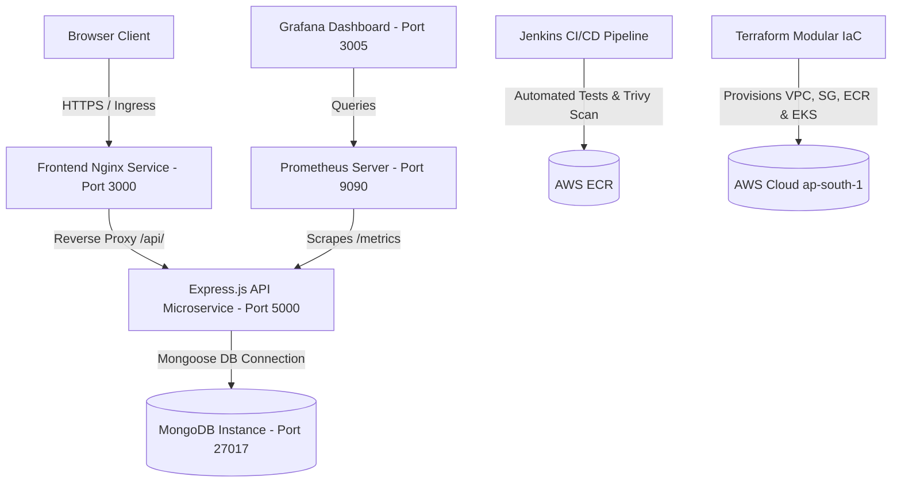

# 💎 LuxeShop | Cloud-Native E-Commerce & DevOps Platform
### Coursework: INT378 Advancements in Cloud and DevOps

A production-grade, highly available e-commerce microservices catalog application built with modern web technologies, Docker containerization, Kubernetes orchestration, Infrastructure as Code (Terraform & AWS CloudFormation), DevSecOps CI/CD automation via Jenkins, and Prometheus/Grafana observability.

---

## 🏗️ Architecture Overview

The system architecture consists of five decoupled service layers designed for resilience, automated scaling, and observability:



### Core Components
1. **Frontend**: Pure HTML5, Vanilla ES6+ JavaScript, and responsive HSL Glassmorphism CSS served via **Nginx Alpine**. Includes real-time catalog search, category pills, wishlist drawer, interactive cart drawer, promo discounts, and system status indicator.
2. **Backend**: **Node.js 20 / Express.js** REST API implementing JWT authentication, bcrypt password hashing, MongoDB models, rate limiting, automated Jest unit tests, and native Prometheus metrics (`/metrics`).
3. **Database**: Persistent **MongoDB 6.0** containerized with Kubernetes PersistentVolumeClaim (`mongo-pvc`).
4. **Container Orchestration**: 
   - Local multi-service composition via `docker-compose.yml`.
   - Production orchestration on **Kubernetes (AWS EKS / Minikube)** with Horizontal Pod Autoscaler (HPA), Ingress controllers, and isolated NetworkPolicies.
5. **Infrastructure as Code (IaC)**:
   - **Modular Terraform**: Clean separation into `provider.tf`, `variables.tf`, `vpc.tf`, `security.tf`, `ecr.tf`, `eks.tf`, and `outputs.tf`.
   - **AWS CloudFormation**: Declarative `cloudformation/template.yaml` for VPC, EC2, and S3 provisioning.
6. **DevSecOps & CI/CD**: Declarative `Jenkinsfile` orchestrating code checkout, Jest unit tests, Docker builds, Trivy container vulnerability scanning, AWS ECR publication, and automated Kubernetes rollouts.
7. **Observability**: **Prometheus** scraper scraping custom latency/throughput counters and alert rules (`k8s/prometheus-rules.yaml`), rendered on live **Grafana** dashboards.

---

## 📂 Project Structure

```
├── backend/
│   ├── controllers/            # Business logic (Auth, Products, Orders, Wishlist)
│   ├── middleware/             # JWT auth, rate limiter, input validator
│   ├── models/                 # Mongoose schemas (User, Product, Order, Wishlist)
│   ├── routes/                 # Express route definitions
│   ├── tests/                  # Automated Jest unit tests (CI/CD integration)
│   ├── Dockerfile              # Production Node.js 20 Alpine builder
│   ├── package.json            # Node.js dependencies and test scripts
│   └── server.js               # Entry point, DB connection, Prometheus metrics
├── frontend/
│   ├── index.html              # Modern glassmorphism e-commerce storefront
│   ├── login.html              # User authentication login interface
│   ├── signup.html             # User registration interface
│   ├── styles.css              # Custom HSL glassmorphism design tokens
│   ├── script.js               # Client-side filtering, cart, wishlist, and API integration
│   ├── Dockerfile              # Static Nginx Alpine container builder
│   └── nginx.conf              # Reverse proxy & static assets configuration
├── k8s/                        # Consolidated Kubernetes Manifests
│   ├── app.yaml                # Backend, Frontend, HPA, Ingress, NetworkPolicy & Secrets
│   ├── database.yaml           # MongoDB PVC, Deployment, and Service
│   └── monitoring.yaml         # Prometheus & Grafana Deployments, Services, Configs & Alerts
├── terraform/                  # Minimal Infrastructure as Code (AWS ap-south-1)
│   ├── main.tf                 # Provider, VPC, Security, ECR, and EKS Cluster
│   └── variables.tf            # Configurable inputs and cluster outputs
├── cloudformation/             # Alternative IaC Stack
│   └── template.yaml           # AWS CloudFormation template for VPC, EC2, and S3
├── monitoring/
│   └── prometheus.yml          # Prometheus local scraping configuration
├── docker-compose.yml          # Multi-container local orchestration
├── Jenkinsfile                 # DevSecOps automated CI/CD pipeline
└── README.md                   # Project documentation
```

---

## 🚀 Execution & Quick Start Guide

### 1. Local Development via Docker Compose

Launch the entire 5-tier microservices stack with a single command:

```powershell
docker compose up -d --build
```

Access services locally:
* **Frontend Web App**: [http://localhost:3000](http://localhost:3000)
* **Backend API Health**: [http://localhost:5000/health](http://localhost:5000/health)
* **Prometheus Metrics**: [http://localhost:5000/metrics](http://localhost:5000/metrics)
* **Prometheus Explorer**: [http://localhost:9090](http://localhost:9090)
* **Grafana Dashboard**: [http://localhost:3005](http://localhost:3005) (Default: `admin` / `admin`)

To stop all services and preserve data:
```powershell
docker compose down
```

---

### 2. Automated Unit Testing (CI/CD Verification)

Run backend tests before deployment:

```powershell
cd backend
npm test
```

---

### 3. Deploying Infrastructure via Terraform

Provision AWS VPC, ECR repositories, and EKS Cluster:

```powershell
cd terraform
terraform init
terraform validate
terraform plan
terraform apply -auto-approve
```

---

### 4. Deploying Kubernetes Manifests

Apply the entire containerized architecture to Kubernetes:

```powershell
# Apply all consolidated manifests (app, database, monitoring)
kubectl apply -f k8s/
```

Verify running pods and services:
```powershell
kubectl get pods -l app=backend
kubectl get pods -l app=frontend
kubectl get hpa
```

---

## 🔒 Updating AWS Credentials & Account ID

To deploy to your own AWS Account:
1. Open [Jenkinsfile](file:///c:/Btech/CLOUD%20COMPUTING%20AND%20DEVOPS%20ESSENTIALS/Project/Jenkinsfile) and update line 6:
   ```groovy
   AWS_ACCOUNT_ID = '<YOUR_NEW_12_DIGIT_ACCOUNT_ID>'
   ```
2. Update Jenkins Credentials (`Manage Jenkins` → `Credentials`):
   - `aws-access-key-id` (Secret text)
   - `aws-secret-access-key` (Secret text)
3. Update local CLI credentials:
   ```powershell
   aws configure
   ```
